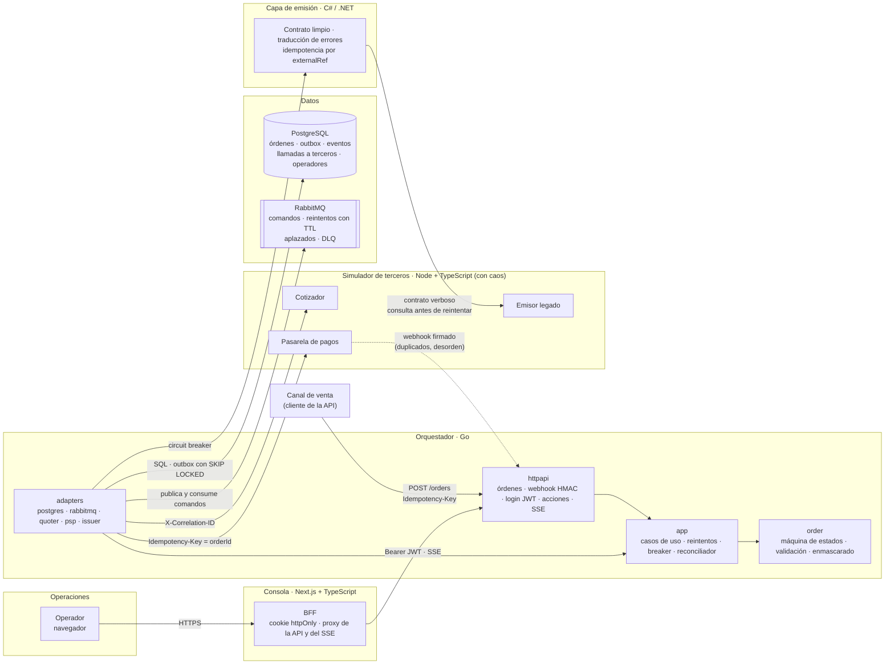
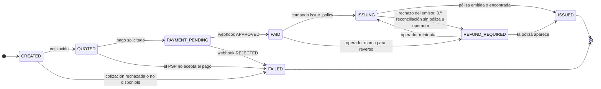

# Póliza digital — orquestación de compra con terceros

Compra de una póliza vehicular digital que cruza tres terceros que fallan de forma independiente: cotizador, pasarela de pagos y emisor legado.

| Carpeta | Contenido |
|---|---|
| `orchestrator/` | Servicio orquestador (Go) |
| `issuing-service/` | Capa anticorrupción del emisor (C# / .NET) |
| `console/` | Consola de operaciones (Next.js + TypeScript) |
| `simulator/` | Simuladores de terceros e inyección de caos |
| `infra/` | Infraestructura como código |
| `review/` | Informe de code review |
| `lead/` | Liderazgo técnico |
| `docs/adr/` | Decisiones de arquitectura |

## 1. Cómo levantar todo en un comando
Requisitos: Docker con Compose v2, bash (en Windows, Git Bash), `curl`, `jq` y `openssl`.

```bash
bash scripts/dev-env.sh                  # crea .env con secretos aleatorios (una sola vez)
docker compose up --build --wait         # PostgreSQL, RabbitMQ, simulador, ACL, orquestador y consola
bash scripts/e2e/run-all.sh              # los 4 escenarios de punta a punta (~1 min)
```

| Servicio | URL |
|---|---|
| **Consola de operaciones** | http://localhost:3000 (usuario y contraseña: `OPS_BOOTSTRAP_USER` / `OPS_BOOTSTRAP_PASSWORD` del `.env`) |
| Orquestador (API + OpenAPI) | http://localhost:8080 · `/openapi.yaml` |
| Capa de emisión (ACL) | http://localhost:8081 |
| Simulador de terceros y caos | http://localhost:8090 · `/chaos` |
| RabbitMQ (colas, reintentos, DLQ) | http://localhost:15672 (usuario y clave del `.env`) |

Los escenarios (compra feliz, timeout pero emitió, caída del emisor con recuperación y pago aprobado con emisión rechazada) están en [`docs/demo.md`](docs/demo.md), que también es el guion del video. El CI los corre en cada push (job `e2e`). La consola está documentada en [`console/README.md`](console/README.md).

## 2. Video de sustentación
_Pendiente._

## 3. Arquitectura



**Cómo fluye una compra:** el orquestador crea la orden con su `Idempotency-Key`, cotiza (reintentos con backoff y jitter) y pide el pago. El webhook del PSP llega firmado, se deduplica y se aplica en orden lógico aunque llegue desordenado. Cada paso asíncrono se guarda en la **outbox** en la misma transacción que el cambio de estado; un despachador lo publica en RabbitMQ y los workers lo procesan con reintentos por TTL y DLQ. La emisión pasa por la **capa anticorrupción** detrás de un circuit breaker: con el circuito abierto, el comando se aplaza sin consumir intentos. El **reconciliador** revisa las órdenes atascadas y consulta al emisor antes de reintentar. Todo el recorrido lleva un **correlation-id por compra** (ADR 0006).

**Estados de la orden** (fuente única: [`orchestrator/internal/order/status.go`](orchestrator/internal/order/status.go)):



Regla clave: **una orden pagada nunca pasa a FAILED.** Si no hay póliza, queda en `REFUND_REQUIRED` y operaciones decide desde la consola, con la acción auditada.

**Orquestador en Go** (hexagonal liviana: las dependencias apuntan hacia `order`):

| Paquete | Responsabilidad |
|---|---|
| `internal/order` | Dominio puro: estados y transiciones, validación, enmascarado de placa y documento. Sin E/S |
| `internal/app` | Casos de uso (crear orden, pedir pago, webhook, emitir, reconciliar, acciones de operador), despachador de la outbox, reintentos y puertos (interfaces) |
| `internal/adapters` | Implementaciones de los puertos: PostgreSQL (`pgx`, migraciones), RabbitMQ y los clientes HTTP del cotizador, el PSP y la capa de emisión |
| `internal/httpapi` | Rutas, firma HMAC del webhook, JWT, SSE, health checks y contrato OpenAPI |
| `internal/auth`, `internal/trace` | Login con bcrypt y JWT; correlation-id en el contexto y en los logs |

**Arquitectura objetivo en AWS** (Bloque 4): en [`docs/architecture.md`](docs/architecture.md), con el diagrama, la justificación de cómputo, mensajería, persistencia y borde, los secretos, los SLI/SLO, el costo, el primer cuello de botella y el borrado según la Ley 1581. La IaC está en [`infra/terraform/messaging`](infra/terraform/messaging).

**Estructura del repositorio**

```
├── orchestrator/      orquestador Go (cmd/, internal/, api/openapi.yaml)
├── issuing-service/   capa anticorrupción C# (Domain, Application, Legacy, Http) y pruebas xUnit
├── console/           consola Next.js (app/, components/, lib/server = BFF, lib/client)
├── simulator/         cotizador, PSP y emisor legado simulados, con /chaos
├── scripts/           generación del .env y escenarios E2E
├── docs/              ADR, guion de la demo, bitácora de IA, capturas
├── review/            informe del code review (Bloque 2)
├── docker-compose.yml
└── .github/workflows/ CI por servicio y job E2E
```

## 4. Decisiones técnicas y por qué
- [ADR 0001 — PostgreSQL como base de datos transaccional](docs/adr/0001-postgresql-como-base-de-datos.md)
- [ADR 0002 — Outbox en PostgreSQL + RabbitMQ para las tareas asíncronas](docs/adr/0002-outbox-y-rabbitmq.md)
- [ADR 0003 — Circuit breaker hacia la capa de emisión, sin consumir intentos con el circuito abierto](docs/adr/0003-circuit-breaker-emision.md)
- [ADR 0004 — Reconciliación de órdenes atascadas y eventos por SSE](docs/adr/0004-reconciliacion-y-sse.md)
- [ADR 0005 — Login JWT para los operadores de la consola](docs/adr/0005-login-jwt-de-operadores.md)
- [ADR 0006 — Un correlation-id por compra, guardado con la orden](docs/adr/0006-correlation-id-por-compra.md)
- [ADR 0007 — Consola con BFF y cookie httpOnly; registro de llamadas a terceros](docs/adr/0007-consola-bff-y-llamadas-a-terceros.md)

## 5. Arquitectura móvil

**Decisión sobre la librería:** no adoptamos `mauron85/react-native-background-geolocation` (sin código nuevo desde 2019; falla al iniciar en Android 12+ y no declara lo que Android 14 exige). Recomendamos Transistorsoft v5 tras un piloto, con `expo-location` como plan B. Evidencia, costo total a 3 años y condiciones de reversión en el [memorando](docs/mobile-memo.md).

Esquema de reporte que asumen las cuatro respuestas: **una posición cada 10 s mientras el vehículo se mueve, agrupadas en un mensaje MQTT por minuto** hacia AWS IoT Core, como en [`docs/architecture.md`](docs/architecture.md). Detenido, no se envían posiciones. La arquitectura dimensiona el costo con envíos las 24 horas: es la cota superior.

### Offline first: 10 minutos en un túnel
- **Almacenar:** cada posición va primero a SQLite en el teléfono, nunca directo a la red. Lleva un `install_id` (UUID generado al instalar la app) y un `seq` creciente y persistido, más la hora del GPS. Si se reinstala la app, el `install_id` cambia y el `seq` puede volver a 0 sin chocar con lo anterior. La cola tiene un tope (7 días o 50.000 posiciones): si se llena, descarta las más viejas y cuenta cuántas descartó, para que el servidor lo sepa.
- **Ordenar:** por `seq`, no por hora de llegada. Al reconectar, primero se envía **la posición más reciente** (la consola ve al vehículo de inmediato) y luego el atraso en orden.
- **Lote:** 10 minutos son 60 posiciones, unos 1.000 bytes: cabe en **un solo mensaje**. Los atrasos largos se parten en lotes de hasta 300 posiciones (~4 KB).
- **Compresión:** Protobuf con deltas de posición y tiempo (≈12 bytes por posición en lugar de ~120 en JSON). gzip solo para lotes de más de 4 KB: en mensajes pequeños, la cabecera de gzip pesa más de lo que ahorra.
- **Backpressure:** MQTT QoS 1. El cliente manda el siguiente lote solo cuando recibe el `PUBACK` del anterior (máximo 2 en vuelo) y, si IoT Core lo limita o la conexión cae, reintenta con espera exponencial y jitter. Al reconectar espera un tiempo aleatorio de 0 a 60 s: cuando una celda vuelve, cientos de vehículos no deben llegar en el mismo segundo. Del lado del servidor, Kinesis absorbe la ráfaga (retiene 24 h) y el consumidor lee a su ritmo.
- **Idempotencia en el servidor:** QoS 1 entrega *al menos una vez*, así que los duplicados son normales. La clave es `(vehicle_id, install_id, seq)`. La última posición en ElastiCache solo se actualiza si la hora del GPS es más reciente que la guardada: una posición vieja que llega tarde no mueve el vehículo hacia atrás. El histórico en Iceberg se deduplica por esa clave al compactar.

### Batería
- **Android:** `FusedLocationProvider` con prioridad alta solo durante el viaje y balanceada al detenerse. Con Activity Recognition, la app detiene las actualizaciones de GPS cuando el vehículo está quieto y las reanuda cuando se mueve. `setMaxUpdateDelayMillis` permite que el sistema agrupe las lecturas y despierte la app con menos frecuencia, una vez por lote. Servicio en primer plano de tipo `location` con su notificación (Android 14+). Guía para los fabricantes que matan procesos (Xiaomi, Huawei, Samsung): pedir la exención de optimización de batería solo en los dispositivos de la flota.
- **iOS:** `activityType = .automotiveNavigation`, `pausesLocationUpdatesAutomatically` y *significant location changes* cuando el vehículo está detenido, para que el sistema despierte la app al volver a moverse. `CLBackgroundActivitySession` (iOS 17+) en lugar de mantener el GPS encendido sin necesidad.
- **Producto:** se rastrea **durante el viaje**, no todo el día. Frecuencia adaptable (cada 10 s en carretera, cada 30 s en trancón) y configurable por flota desde el servidor. Un mensaje por minuto, no por posición: cada vez que el radio celular se enciende gasta energía varios segundos después de transmitir. Panel de batería por versión de la app para detectar regresiones.

### Consumo de datos (límite: 20 MB por vehículo al mes)
Supuestos: 10 horas de movimiento al día, 30 días, MQTT sobre TLS 1.3 con conexión persistente.

| Concepto | Cálculo | MB al mes |
|---|---|---|
| Posiciones | 600 mensajes/día × 30 = 18.000 mensajes × ~400 B (≈200 B de posiciones con margen + ~200 B de MQTT, TLS, TCP y el `PUBACK`) | 7,2 |
| Keepalive con el vehículo detenido | Un ping cada 20 min durante 14 h × 30 días × ~130 B | 0,2 |
| Reconexiones (túneles, cambio de celda) | 20 por día × 30 × ~7 KB (handshake TLS con certificado de dispositivo) | 4,2 |
| Configuración y comandos | Estimado | 0,2 |
| **Subtotal** | | **11,8** |
| **Con 30 % de retransmisiones y margen** | | **≈ 15,3** |

**Cabe en 20 MB**, con dos condiciones. Con el mismo margen, reportar las 24 horas aunque el vehículo esté quieto da ≈ 28 MB (43.200 mensajes × 400 B + reconexiones y comandos, × 1,3): no cabe, por eso solo se envía en movimiento. Con HTTPS y JSON, cada petición pesaría ~1,6 KB (≈ 700 B de cabeceras de petición y respuesta, ≈ 600 B de JSON con 6 posiciones y ≈ 300 B de TCP y TLS): 18.000 × 1,6 KB + reconexiones, × 1,3 ≈ 43 MB. Por eso MQTT y Protobuf. Las actualizaciones de la app (2–5 MB cada una) se descargan solo por Wi-Fi y no cuentan en el plan. **El trade-off:** si negocio pide una posición por segundo (para calificar la conducción, por ejemplo), no cabe. Habría que calcular en el teléfono y enviar eventos (frenadas, excesos de velocidad) en lugar de posiciones crudas, o pagar un plan mayor.

### Distribución y permisos
- **Google Play exige hoy:** declarar el permiso de ubicación en segundo plano en Play Console (formulario de permisos de ubicación, en "Contenido de la app"), con un video corto del flujo en el dispositivo; una **divulgación destacada** dentro de la app, antes del diálogo del sistema, que diga "ubicación" y "incluso cuando la app está cerrada o no se está usando"; y política de privacidad en la app y en la ficha. En Android 11+, `ACCESS_BACKGROUND_LOCATION` se pide aparte, después del permiso en uso, y el usuario lo concede en Ajustes ("Permitir todo el tiempo"). Android 14 exige el tipo `location` en el servicio en primer plano y el permiso `FOREGROUND_SERVICE_LOCATION`. Desde el 31 de agosto de 2026 las actualizaciones deben apuntar a la API 36.
- **Cómo reducir el riesgo de rechazo:** si el conductor inicia el viaje desde la app, un servicio en primer plano iniciado con la app visible puede usar solo el permiso **en uso**. Pedimos el de segundo plano solo si negocio necesita detectar viajes automáticamente, y lo justificamos en la declaración.
- **Actualizaciones en una flota de miles:** dos canales. **OTA (EAS Update)** para cambios de JavaScript: la política de Google Play lo permite si no cambia el propósito de la app. Se publica por porcentajes (5 % → 25 % → 100 %) y se revierte solo si la tasa de crashes sube. **Tienda** para cualquier cambio nativo (permisos, SDK, la librería de ubicación), con el lanzamiento escalonado de Play. En teléfonos de la empresa, Managed Google Play (MDM) instala las actualizaciones sin depender del conductor. El servidor publica la **versión mínima soportada**: una app más vieja pide actualizarse en lugar de enviar datos con un protocolo que ya no se acepta. El backend acepta las dos últimas versiones del mensaje de telemetría.

## 6. Reporte de IA
_Pendiente._ Bitácora en construcción en `docs/ai/`.

## 7. Decisiones y renuncias
_Pendiente._
