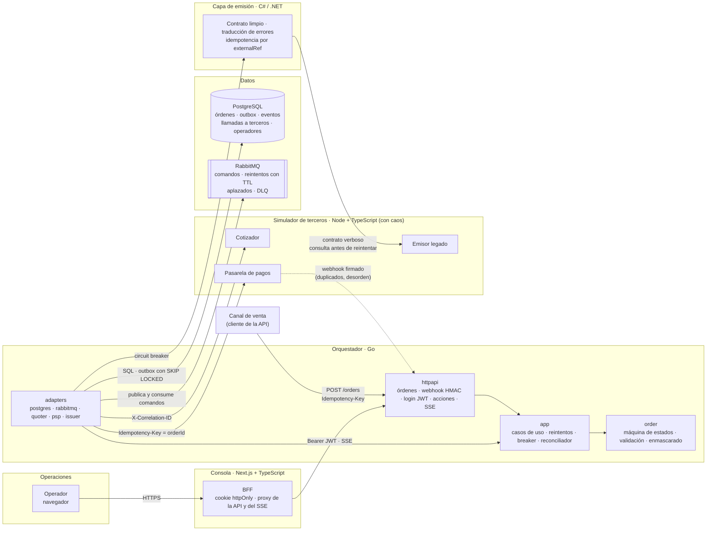
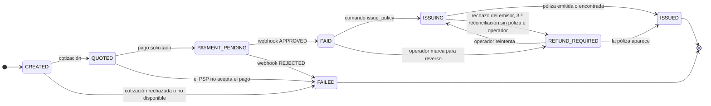

# Póliza digital — orquestación de compra con terceros

Compra de una póliza vehicular digital que cruza tres terceros que fallan de forma independiente: cotizador, pasarela de pagos y emisor legado.

| Carpeta | Contenido |
|---|---|
| `orchestrator/` | Servicio orquestador (Go) |
| `issuing-service/` | Capa anticorrupción del emisor (C# / .NET) |
| `console/` | Consola de operaciones (Next.js + TypeScript) |
| `simulator/` | Simuladores de terceros e inyección de caos |
| `infra/` | Infraestructura como código |
| `review/` | Informe de code review |
| `lead/` | Liderazgo técnico |
| `docs/adr/` | Decisiones de arquitectura |

## 1. Cómo levantar todo en un comando
Requisitos: Docker con Compose v2, bash (en Windows, Git Bash), `curl`, `jq` y `openssl`.

```bash
bash scripts/dev-env.sh                  # crea .env con secretos aleatorios (una sola vez)
docker compose up --build --wait         # PostgreSQL, RabbitMQ, simulador, ACL, orquestador y consola
bash scripts/e2e/run-all.sh              # los 4 escenarios de punta a punta (~1 min)
```

| Servicio | URL |
|---|---|
| **Consola de operaciones** | http://localhost:3000 (usuario y contraseña: `OPS_BOOTSTRAP_USER` / `OPS_BOOTSTRAP_PASSWORD` del `.env`) |
| Orquestador (API + OpenAPI) | http://localhost:8080 · `/openapi.yaml` |
| Capa de emisión (ACL) | http://localhost:8081 |
| Simulador de terceros y caos | http://localhost:8090 · `/chaos` |
| RabbitMQ (colas, reintentos, DLQ) | http://localhost:15672 (usuario y clave del `.env`) |

Los escenarios (compra feliz, timeout pero emitió, caída del emisor con recuperación y pago aprobado con emisión rechazada) están en [`docs/demo.md`](docs/demo.md), que también es el guion del video. El CI los corre en cada push (job `e2e`). La consola está documentada en [`console/README.md`](console/README.md).

## 2. Video de sustentación
_Pendiente._

## 3. Arquitectura



**Cómo fluye una compra:** el orquestador crea la orden con su `Idempotency-Key`, cotiza (reintentos con backoff y jitter) y pide el pago. El webhook del PSP llega firmado, se deduplica y se aplica en orden lógico aunque llegue desordenado. Cada paso asíncrono se guarda en la **outbox** en la misma transacción que el cambio de estado; un despachador lo publica en RabbitMQ y los workers lo procesan con reintentos por TTL y DLQ. La emisión pasa por la **capa anticorrupción** detrás de un circuit breaker: con el circuito abierto, el comando se aplaza sin consumir intentos. El **reconciliador** revisa las órdenes atascadas y consulta al emisor antes de reintentar. Todo el recorrido lleva un **correlation-id por compra** (ADR 0006).

**Estados de la orden** (fuente única: [`orchestrator/internal/order/status.go`](orchestrator/internal/order/status.go)):



Regla clave: **una orden pagada nunca pasa a FAILED.** Si no hay póliza, queda en `REFUND_REQUIRED` y operaciones decide desde la consola, con la acción auditada.

**Orquestador en Go** (hexagonal liviana: las dependencias apuntan hacia `order`):

| Paquete | Responsabilidad |
|---|---|
| `internal/order` | Dominio puro: estados y transiciones, validación, enmascarado de placa y documento. Sin E/S |
| `internal/app` | Casos de uso (crear orden, pedir pago, webhook, emitir, reconciliar, acciones de operador), despachador de la outbox, reintentos y puertos (interfaces) |
| `internal/adapters` | Implementaciones de los puertos: PostgreSQL (`pgx`, migraciones), RabbitMQ y los clientes HTTP del cotizador, el PSP y la capa de emisión |
| `internal/httpapi` | Rutas, firma HMAC del webhook, JWT, SSE, health checks y contrato OpenAPI |
| `internal/auth`, `internal/trace` | Login con bcrypt y JWT; correlation-id en el contexto y en los logs |

**Estructura del repositorio**

```
├── orchestrator/      orquestador Go (cmd/, internal/, api/openapi.yaml)
├── issuing-service/   capa anticorrupción C# (Domain, Application, Legacy, Http) y pruebas xUnit
├── console/           consola Next.js (app/, components/, lib/server = BFF, lib/client)
├── simulator/         cotizador, PSP y emisor legado simulados, con /chaos
├── scripts/           generación del .env y escenarios E2E
├── docs/              ADR, guion de la demo, bitácora de IA, capturas
├── review/            informe del code review (Bloque 2)
├── docker-compose.yml
└── .github/workflows/ CI por servicio y job E2E
```

## 4. Decisiones técnicas y por qué
- [ADR 0001 — PostgreSQL como base de datos transaccional](docs/adr/0001-postgresql-como-base-de-datos.md)
- [ADR 0002 — Outbox en PostgreSQL + RabbitMQ para las tareas asíncronas](docs/adr/0002-outbox-y-rabbitmq.md)
- [ADR 0003 — Circuit breaker hacia la capa de emisión, sin consumir intentos con el circuito abierto](docs/adr/0003-circuit-breaker-emision.md)
- [ADR 0004 — Reconciliación de órdenes atascadas y eventos por SSE](docs/adr/0004-reconciliacion-y-sse.md)
- [ADR 0005 — Login JWT para los operadores de la consola](docs/adr/0005-login-jwt-de-operadores.md)
- [ADR 0006 — Un correlation-id por compra, guardado con la orden](docs/adr/0006-correlation-id-por-compra.md)
- [ADR 0007 — Consola con BFF y cookie httpOnly; registro de llamadas a terceros](docs/adr/0007-consola-bff-y-llamadas-a-terceros.md)

## 5. Arquitectura móvil
_Pendiente._

## 6. Reporte de IA
_Pendiente._ Bitácora en construcción en `docs/ai/`.

## 7. Decisiones y renuncias
_Pendiente._
