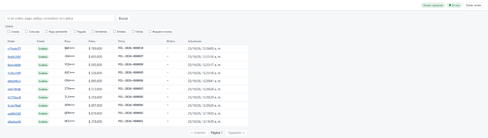
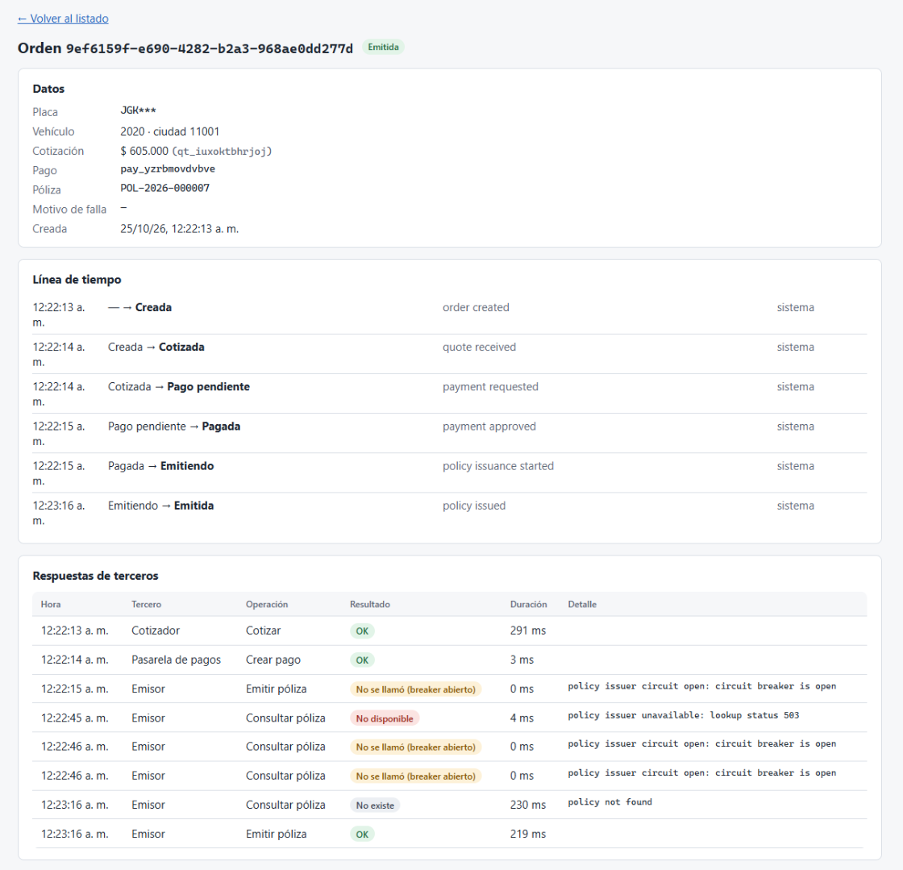

# Consola de operaciones

Next.js (App Router) + TypeScript `strict`. Un operador inicia sesión, busca órdenes, ve su línea de tiempo y lo que respondió cada tercero, ejecuta las acciones operativas y ve los cambios en vivo.





## Cómo funciona

```
Navegador ──(cookie httpOnly)──▶ Next.js (BFF: /api/*) ──(Authorization: Bearer)──▶ Orquestador
```

- **BFF (backend for frontend).** El navegador solo habla con Next.js. Los route handlers de `src/app/api/` reenvían al orquestador (`src/lib/server/bff.ts`).
- **El JWT vive en una cookie `httpOnly`, `Secure` y `SameSite=Strict`.** El JavaScript de la página nunca lo ve, así que un XSS no puede robarlo. Al navegador solo le llega la hora de vencimiento. Si el orquestador responde 401 (token vencido), el BFF borra la cookie y la página vuelve al login.
- **CSRF:** `SameSite=Strict`, y además el BFF rechaza los POST cuyo `Origin` sea otro sitio.
- **Rutas seguras:** un id de orden que no sea UUID no llega al orquestador (`src/lib/server/paths.ts`), así que `../ops/breakers` no se convierte en otra ruta firmada con el token del operador.
- **En vivo con SSE.** `EventSource("/api/stream")`: el BFF abre `/events/stream` en el orquestador y reenvía el flujo. Al reconectar, el navegador manda `Last-Event-ID` y el orquestador entrega lo que se perdió. Hay una sola conexión para toda la consola (`LiveEvents.tsx`). Por qué SSE y no WebSocket ni polling: [ADR 0004](../docs/adr/0004-reconciliacion-y-sse.md).
- **Tipos del contrato:** `src/lib/api/schema.d.ts` se genera desde `orchestrator/api/openapi.yaml` con `npm run gen:api`. El CI falla si quedó desactualizado (`npm run check:api`), y el orquestador valida sus respuestas reales contra ese mismo OpenAPI.

## Pantallas

| Pantalla | Qué hace |
|---|---|
| Login | Credenciales inválidas, 429 con "espera N segundos" y servicio caído, cada uno con su mensaje |
| Listado | Filtro por estado, búsqueda (id de orden, pago, póliza, correlation-id o placa) y paginación por cursor. Cada evento actualiza la fila al instante y recarga la página una vez, para respetar el filtro |
| Detalle | Datos, línea de tiempo con el actor y respuestas de terceros: cada intento con resultado, duración y error, incluido "no se llamó (breaker abierto)" |
| Acciones | "Reintentar emisión" (ISSUING, REFUND_REQUIRED) y "Marcar para reverso" (PAID, ISSUING), solo cuando aplican. Diálogo de confirmación accesible (`<dialog>`, Escape, foco inicial en Cancelar). Un 409 muestra el estado real |
| Barra superior | Estado del breaker del emisor (consulta cada 5 s) e indicador de conexión en vivo |

La placa llega enmascarada (`ABC***`) y el documento nunca sale del orquestador.

## Comandos

```bash
npm ci
npm run dev          # http://localhost:3000; necesita el orquestador (ORCHESTRATOR_URL, por defecto http://localhost:8080)
npm test             # Vitest: reglas de acciones, eventos en vivo, BFF (cookie, 401, CSRF, SSE) y rutas
npm run lint && npm run typecheck
npm run gen:api      # regenera los tipos tras cambiar el OpenAPI
```

| Variable | Por defecto | Uso |
|---|---|---|
| `ORCHESTRATOR_URL` | `http://localhost:8080` | Dónde está el orquestador (en compose: `http://orchestrator:8080`) |
| `COOKIE_SECURE` | `true` | `false` solo para servir la consola por http fuera de localhost |

**Renuncias:** sin dark mode, sin dashboard, sin gestión de operadores ni i18n (solo español y formato es-CO), y sin pruebas de navegador en el CI. La consola se verificó a mano en Chrome con los escenarios de `scripts/e2e/`.
