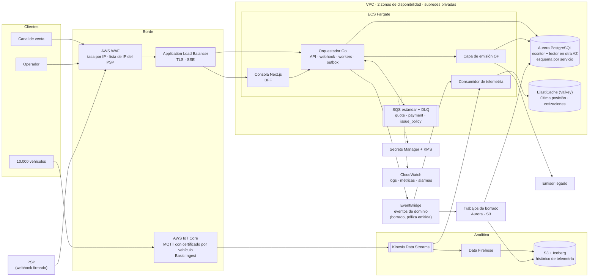

# Arquitectura objetivo en AWS

Cómo correría en AWS el sistema del Bloque 1 a la escala de referencia: 10.000 órdenes por día, picos de 50 solicitudes por segundo y 10.000 vehículos activos que emiten telemetría. Nada de esto está desplegado; el fragmento de IaC está en [`infra/terraform/messaging`](../infra/terraform/messaging) y pasa `terraform validate`.

**Lo que la escala dice antes de elegir servicios.** 10.000 órdenes por día son 0,12 por segundo en promedio. Incluso el pico de 50 rps es poco para cualquier opción: **el cuello no está en el volumen de compras sino en dos lugares** — los terceros lentos (sobre todo el emisor legado) y la telemetría, que con una posición por minuto y vehículo son ~170 mensajes por segundo sostenidos, 1.400 veces el volumen de órdenes. Por eso la telemetría va por un camino separado y nunca toca la base transaccional.

## 1. Diagrama

## 2. Por qué estas piezas

| Decisión | Elegido | Por qué, y qué se descartó |
|---|---|---|
| **Cómputo** | **ECS Fargate** | Los servicios ya son contenedores y varios son **procesos de larga vida**: el despachador de la outbox, los workers de la cola, el reconciliador y los flujos SSE de la consola. Lambda no sirve para un SSE abierto ni para un despachador que sondea la base en bucle, y cobraría por cada espera. EKS agrega un plano de control (~US$73/mes) y una plataforma que operar para cuatro servicios y un equipo pequeño: no se paga. Fargate escala por tarea y no hay servidores que parchar. |
| **Mensajería** | **SQS estándar + DLQ**, más **EventBridge** para eventos de dominio | Los comandos (cotizar, cobrar, emitir) tienen **un solo consumidor**: es una cola punto a punto, justo lo que hace SQS, con DLQ y `maxReceiveCount` nativos. Reemplaza a RabbitMQ sin tocar el dominio (ADR 0002): la **outbox se mantiene** para que el cambio de estado y el comando sean atómicos. **No FIFO:** el orden ya lo garantiza la máquina de estados y la idempotencia por estado y `externalRef`; FIFO limitaría el rendimiento sin aportar. Con el breaker abierto, el comando se **reencola como mensaje nuevo con `DelaySeconds`** y se borra el original: `ChangeMessageVisibility` no sirve, porque SQS cuenta cada recepción y el comando acabaría en la DLQ (ADR 0003). Los intentos reales viajan en un atributo del mensaje. SNS no hace falta para comandos. EventBridge sí, para los **eventos** con varios interesados: póliza emitida y solicitud de borrado (sección 8). |
| **Persistencia** | **Aurora PostgreSQL** (ADR 0001) | La orden es una máquina de estados con transacciones, outbox con `SKIP LOCKED` y consultas ad hoc de operaciones: es relacional. DynamoDB obligaría a modelar la outbox y las consultas de la consola con índices secundarios y transacciones limitadas. Aurora frente a RDS: conmutación por error más rápida (~30 s), réplica de lectura sin copiar almacenamiento y almacenamiento que crece solo. A esta escala, dos instancias pequeñas sobran. La **última posición** de cada vehículo va a ElastiCache, no a Aurora: se sobrescribe cada minuto y no necesita historia transaccional. |
| **Borde** | **ALB + AWS WAF** | La consola usa **SSE**: conexiones de minutos. API Gateway corta las peticiones a los 29–30 s, así que rompería el flujo en vivo. El costo no decide: a este volumen los dos cuestan poco. WAF aplica el límite de intentos del login por IP (lo que ADR 0005 no puede hacer en memoria con varias réplicas) y una lista de IP permitidas para el webhook del PSP, además de la firma HMAC. Para los vehículos el borde es **IoT Core**: autenticación con certificado por dispositivo, MQTT tolerante a mala cobertura y Basic Ingest, que enruta directo a Kinesis y, según la documentación de AWS, no paga mensajería (supuesto que hay que confirmar, ver la sección 6). |

**Región:** `us-east-1` por costo y catálogo de servicios. Guardar datos personales fuera de Colombia es una transferencia internacional (artículo 26 de la Ley 1581): exige un país con nivel adecuado de protección según la SIC o una de las excepciones de la ley, como la autorización expresa del titular. **Lo confirma el área legal antes de producción.** Si no se aprueba, la alternativa es `sa-east-1` (São Paulo), con precios más altos.

## 3. Infraestructura como código

[`infra/terraform/messaging`](../infra/terraform/messaging) define el componente donde un error cuesta dinero: la **cola de emisión**. Las colas `quote` y `payment` del diagrama repetirían el mismo patrón y no están en el módulo.

- Cola `issue_policy` con DLQ (`maxReceiveCount = 4`, igual a los intentos del orquestador), cifrado administrado por SQS, long polling y un *visibility timeout* (60 s) mayor que un intento completo: consulta y emisión de 10 s cada una.
- Una política de redrive que solo permite a esa cola escribir en su DLQ.
- Política IAM de **mínimo privilegio** para el rol de la tarea del orquestador: enviar (también para aplazar), recibir, borrar y extender la visibilidad. No puede purgar ni borrar colas.
- Alarmas con destinos distintos (ver la sección 5). **Llaman a guardia** la orden pagada sin póliza más antigua (métrica que publicaría el reconciliador desde la base; está diseñada, no implementada) y un comando que nadie consume. Un mensaje en la DLQ **abre un ticket**. La primera no sale de SQS a propósito: cada aplazamiento reencola el comando y reinicia su edad en la cola.

## 4. Secretos y configuración

| Qué | Dónde | Rotación |
|---|---|---|
| Credenciales de Aurora | Secrets Manager, contraseña administrada por RDS | Automática cada 30 días, sin reinicio (el pool reconecta con la credencial nueva) |
| Llaves de API del cotizador, el PSP y el emisor (previstas: hoy el simulador no las exige) | Secrets Manager, un secreto por tercero y entorno, cifrado con una llave KMS propia | Cada 90 días o ante sospecha. Si el tercero permite dos llaves activas: crear la nueva, desplegar, revocar la vieja. Si no: ventana acordada y runbook |
| Secreto del webhook del PSP y del JWT de operadores | Secrets Manager | **Doble llave durante la rotación**: el servicio acepta la firma con la llave actual y la anterior, y firma solo con la actual. **Requiere un cambio menor en el código**: hoy acepta una sola llave |
| Configuración no secreta (URL de terceros, timeouts, umbrales) | SSM Parameter Store | Versionada con el despliegue |

Reglas: los secretos llegan a cada tarea por `secrets` de la *task definition*, nunca en la imagen ni en variables escritas en el código. **Cada servicio tiene su rol y solo lee sus secretos**: la capa de emisión no ve la llave del PSP. Diseño para el despliegue (no implementado en este repositorio): el CI despliega con OIDC de GitHub, sin llaves de AWS guardadas; leer un secreto queda en CloudTrail, con una alarma si un rol lee un secreto que no es suyo. La aplicación se niega a arrancar si falta un secreto, como el orquestador con `JWT_SECRET`.

## 5. Observabilidad: SLI, SLO y alertas

| SLI | Cómo se mide | SLO (28 días) |
|---|---|---|
| **Creación de órdenes disponible** | Peticiones `POST /orders` sin respuesta 5xx ÷ total (los 4xx son del cliente y no cuentan) | 99,5 % |
| **Emisión a tiempo** | Órdenes pagadas que llegan a `ISSUED` en 5 minutos o menos ÷ órdenes pagadas | 99 % |
| **Ningún pago sin resolver** | Órdenes pagadas que, a los 30 minutos, están en `ISSUED` o en `REFUND_REQUIRED` con una acción de operador registrada (las acciones quedan con su actor, ADR 0005) ÷ órdenes pagadas | 99,9 % |

El tercero es el que importa al negocio: un cliente que pagó y no tiene póliza ni respuesta. Se mide desde la base (los timestamps de `order_events`), no desde los logs.

**Alertas que despiertan a alguien:**
- Consumo rápido del presupuesto de error de cualquier SLO: más de 14 veces el ritmo permitido en 1 hora **y** en los últimos 5 minutos. Las dos ventanas evitan alertar por un pico que ya pasó.
- Una orden pagada lleva más de 10 minutos sin póliza, durante 5 minutos seguidos, o un comando de emisión lleva ese tiempo sin consumirse (las dos en el Terraform).
- El breaker hacia el emisor sigue abierto más de 15 minutos.
- Ninguna orden creada en 15 minutos en horario de venta (el canal de venta dejó de llegar).

**Alertas que abren un ticket** (horario laboral): consumo lento del presupuesto (6 veces en 6 horas), mensajes en una DLQ, órdenes en `REFUND_REQUIRED` sin acción por más de 30 minutos (el plazo del tercer SLI) y certificados que vencen en 30 días.

**Lo que deliberadamente no alerta** (para no entrenar al equipo a ignorar alarmas):
- Cada reintento, cada aplazamiento por el breaker y cada apertura del breaker que se cierra sola: es el sistema funcionando como se diseñó.
- Un 5xx aislado, un timeout del cotizador o la CPU o la memoria altas **si el SLO está bien**: son causas, no síntomas.
- Los 4xx de clientes y los webhooks duplicados del PSP: son normales.
- Las alarmas de staging: van a un canal, nunca a guardia.

Toda alarma que llama a guardia tiene un runbook enlazado. Si una alarma se ignoró dos veces en un mes, se corrige o se borra.

**Runbook de emisión (resumen):** 1) ver en `GET /ops/breakers` (requiere sesión de operador) si el breaker está abierto; 2) si el emisor está caído, avisar al proveedor y dejar que el aplazamiento haga su trabajo; 3) si el emisor responde y la cola no baja, revisar las tareas del worker; 4) nunca reemitir a mano sin consultar antes al emisor por `externalRef`.

## 6. Costo mensual estimado

Supuestos: un solo entorno productivo en `us-east-1`, precios de lista aproximados de 2026 (hay que confirmarlos en AWS Pricing Calculator), sin planes de ahorro, y **un mensaje de telemetría por vehículo y minuto** (con las posiciones del minuto agrupadas, unos 200 bytes).

| Partida | Supuesto | US$/mes |
|---|---|---|
| ECS Fargate | Orquestador 2 × (0,5 vCPU, 1 GB); capa de emisión y consola 2 × (0,25 vCPU, 0,5 GB) cada una; consumidor de telemetría 2 × (0,5 vCPU, 1 GB) | ~110 |
| Aurora PostgreSQL | 2 × db.t4g.medium (escritor + lector en otra AZ), 20 GB, I/O bajo | ~120 |
| Telemetría: IoT Core | 432 millones de mensajes al mes con Basic Ingest: se cobran las reglas y las acciones (~US$0,30 por millón), más la conectividad de 10.000 vehículos siempre conectados (~US$35). **Supuesto que hay que confirmar:** que los mensajes a los temas de Basic Ingest no pagan mensajería. Sin Basic Ingest se suman ~US$432 de mensajería | ~165 (~600 sin Basic Ingest) |
| Kinesis, Firehose y S3 | 1 shard aprovisionado (~170 registros por segundo frente a un cupo de 1.000) y ~90 GB al mes hacia S3 | ~25 |
| NAT Gateway | 2 AZ más tráfico de salida hacia los terceros | ~75 |
| ElastiCache (Valkey) | 2 × cache.t4g.small | ~50 |
| ALB + WAF | 1 ALB, 3 reglas de WAF | ~40 |
| CloudWatch | ~30 GB de logs al mes, métricas y alarmas | ~30 |
| SQS, Secrets Manager, KMS, ECR y copias de seguridad | ~3 millones de mensajes al mes, ~10 secretos | ~25 |
| **Total** | | **~US$640 al mes** (~US$1.075 si Basic Ingest no aplica) |

Un entorno de staging reducido suma entre 30 y 40 %. Las compras son una fracción pequeña del costo: **la telemetría ya es la partida más grande**.

**La primera partida que se dispara a 10 veces** (100.000 vehículos o 100.000 órdenes por día) es la **telemetría**: escala lineal con los vehículos y no con las compras. IoT Core pasa de ~165 a ~1.650 US$ al mes (o de ~600 a ~6.000 sin Basic Ingest). Kinesis apenas sube: 1.700 registros por segundo caben en 2–3 shards (~100 US$ con las unidades de escritura). A eso se suma el consumidor en Fargate. Las órdenes a 10 veces siguen siendo 1,2 por segundo en promedio: Aurora y Fargate apenas suben. Palancas, en orden: confirmar Basic Ingest antes de lanzar, agrupar más posiciones por mensaje (cada 2 minutos baja a la mitad la parte que se cobra por mensaje, no la conectividad) y enviar solo cuando el vehículo se mueve.

## 7. Qué se rompe primero

**El emisor legado.** Nuestro diseño absorbe el pico de 50 rps en la creación, pero cada compra pagada termina en una llamada al emisor, que es lento, inestable y tiene un cupo de concurrencia que no controlamos. Si un pico de ventas coincide con una degradación del emisor, el breaker se abre (bien), los comandos se aplazan (bien) y la cola `issue_policy` crece. El cliente pagó y espera su póliza mientras la cola drena al ritmo del emisor. No se rompe nada, pero **el SLO de emisión a tiempo se consume en minutos**. Se detecta antes que el cliente por tres señales: la orden pagada sin póliza más antigua (alarma a los 10 minutos, antes de que el cliente se canse de esperar), la latencia p95 de la capa de emisión hacia el emisor, que sube antes de que el breaker se abra (está en el panel, no alerta por sí sola), y el consumo rápido del presupuesto del SLO de emisión. Lo siguiente que se rompería son las **conexiones a Aurora** cuando Fargate escala muchas tareas a la vez: se detecta con `DatabaseConnections` frente al máximo de la instancia, y se resuelve con RDS Proxy antes de necesitar una instancia más grande.

## 8. Consistencia y borrado

**Dónde viven los datos personales:** placa y documento del cliente en Aurora (órdenes, eventos y registro de llamadas a terceros), la última posición y las cotizaciones en ElastiCache, el histórico de telemetría en S3 y las copias de seguridad de Aurora. Los logs ya salen con la placa y el documento enmascarados (los tipos `Plate` y `DocumentID` de `orchestrator/internal/order/identity.go` se enmascaran solos al registrarse o serializarse) y se retienen 30 días.

**Marco legal aplicado** (Ley 1581 de 2012 y Decreto 1377 de 2013, compilado en el Decreto 1074 de 2015): el titular tiene derecho a pedir la supresión de sus datos y a revocar la autorización. El reclamo se atiende en un plazo de 15 días hábiles, prorrogable 8 más con aviso al titular. La supresión **no procede** cuando existe un deber legal o contractual de conservar el dato: la póliza emitida y su pago se conservan por las obligaciones contables y del contrato de seguro, con acceso restringido. La **ubicación del vehículo** se trata con el mismo cuidado que un dato sensible: revela los hábitos de una persona.

**Cómo se garantiza el borrado en todos los almacenes:**
1. La solicitud se registra en Aurora, en la **misma transacción** que una *lápida* (vehículo o cliente, fecha y alcance) y que un evento en la outbox. Desde ese momento las APIs no devuelven ese titular, aunque los demás almacenes todavía no hayan terminado.
2. El evento sale por EventBridge hacia cada almacén, y cada consumidor **confirma** en una tabla de seguimiento:
   - **ElastiCache:** borra las claves del vehículo o cliente. Respaldo: todas las claves tienen TTL de 24 horas, así que nada sobrevive más que eso aunque el evento se pierda.
   - **Aurora:** borra o anonimiza los datos personales de órdenes no emitidas y del registro de llamadas a terceros. Las pólizas emitidas se conservan por obligación legal, con placa y documento cifrados y fuera de los listados.
   - **S3 (telemetría):** las tablas Iceberg permiten `DELETE` por `vehicle_id`. Un trabajo diario reescribe las particiones afectadas.
3. Un **reconciliador de borrado** revisa cada día las solicitudes sin todas las confirmaciones. Si alguna supera las 72 horas, alerta (ticket). El reclamo se cierra ante el titular solo cuando todos los almacenes confirmaron.

**Rezago, dicho de forma explícita:** inmediato en las APIs (por la lápida), hasta 24 horas en caché (TTL) y hasta 72 horas en analítica. Las **copias de seguridad** de Aurora (35 días) no se editan: si se restaura una, se vuelven a aplicar las lápidas antes de abrirla al tráfico, y el paso está en el runbook de restauración. Por eso **las lápidas se conservan más que la copia más vieja**: como mínimo 35 días y, en la práctica, indefinidamente. No guardan datos personales, solo un hash del identificador, el alcance y la fecha. La política de privacidad informa estos plazos al titular.
